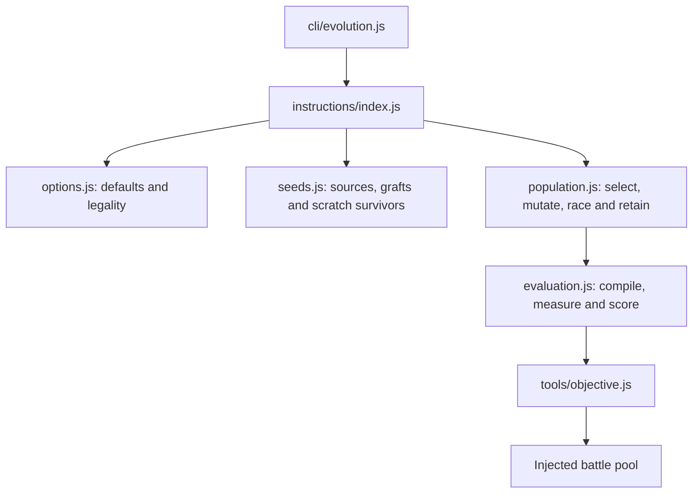

# Evolution module map

Search implementations live here. CLI modules load inputs and write artifacts;
search modules operate on compiled warriors and an injected battle pool. The VM
and match backends remain in `src/engine/`.

| Search | Entry point | Responsibility |
| --- | --- | --- |
| Instructions | `instructions/index.js`: `evolve(options)` | Run generations, Red Queen opponents, leagues and reporting. |
| Block recipes | `blocks.js`: `evolveBlocks(options)` | Breed verified recipe families and keep family specialists. |
| Generator parameters | `parameters.js`: `evolveParameters(options)` | Search bounded constants using caller-supplied build and evaluation functions. |
| Algebra trees | `trees/search.js`: `evolveTrees(options)` | Breed gated block trees, learn mutation counters and retain behaviour/shape niches. |
| Hill progression | `trees/ladder.js`: `climbTrees(options)` | Select rungs, sample cleared opponents, resume climbs and carry champions forward. |
| Hill placement | `trees/placement.js`: `placeOnHill(options)` | Rank a warrior against a cached hill round robin. |

These searches have different admission gates and retention policies. They share
selection, objectives and execution where those contracts actually agree.

## Instruction search

- `options.js` normalizes settings, checks supported feature combinations and
  applies entry/geometry length limits before any battles run. CLI parsing and
  programmatic search use its shared `validateInstructionSearch` policy.
- `seeds.js` constructs the initial population using the run's seeded RNG.
- `evaluation.js` owns candidate identity, lineage and both caches. Compilation
  and solo measurements persist through the run; `reset()` invalidates fitness
  at each generation because opponents and placement seeds change. Assessments
  are keyed by population, racing level and genome. Pending promises are cached
  too, so simultaneous duplicate births do not repeat the work.
- `population.js` owns archive replacement, GA truncation or lexicase survival,
  mutation credit, local numeric refinement and racing finalists. It commits
  results in birth order even when the backend evaluates concurrently.
- `index.js` coordinates generations and league opponents. Fitness is reset
  before breeding; each population's rivals stay fixed during that breeding run.

`execution.js` counts battle work while preserving live backend getters and solo
acceleration, including GPU-to-CPU fallback. `identity.js` supplies stable genome
IDs without loading the search implementation.

Tree selection uses the same tie reward as fitness. Numeric tuning (`ops:
['tune']`) requires starting trees and preserves their structures through
seeding and ladder runs. Tree results include `finalists`, ranked on common
finals seeds and rounds, separately from niche `archive` scores. Export and hill
progression include the confirmed champion even when its screening rank was low.

Recipe and parameter searches cache accepted and refused genotypes for the run;
their build/gate callbacks must be deterministic for a given genotype.
`stats.proposed` counts all proposals, `stats.duplicates` counts repeat proposals
(including refusals), and `stats.rejected` counts distinct refused genotypes.

## Shared tools and CLI

`tools/genes.js` owns instruction genomes and mutations; `tools/selection.js`
owns lexicase and outcome niches. `tools/objective.js` owns points, smooth and
push-off fitness. `tools/training.js` owns ruleset profiles and independent
validation on fresh placements. Tree construction and contracts stay in
`tools/algebra/`; searching and climbing stay here.

`cli/evolution.js` dispatches representations and runs training campaigns.
`cli/tree-evolution.js` handles tree/counter files and ladder artifacts;
`cli/block-devtools.js` handles recipe files. They share opponent loading,
backend creation and progress output through `cli/devtools-context.js`.

The former entry points (`tools/evolve.js`, `tools/block-evolve.js`,
`tools/parameter-evolve.js`, `tools/algebra/evolve.js`, and evolution exports in
`cli/devtools.js`) remain compatible. Existing commands and output formats are
preserved, with the additive tree `finalists` field and unique refusal counters
described above. New implementation changes belong in the modules above.

## Verification

`node --test test/evolution-regression.test.js test/evolution-backends.test.js
test/training.test.js test/league.test.js test/racing.test.js` covers instruction
results, backend scheduling, legality, validation and league/racing contracts.
The regression hashes capture complete seeded results from commit `499a698`
before the refactor; intentional algorithm changes require reviewing them.

`node --test test/algebra-evolve.test.js test/algebra-counters.test.js
test/block-evolve.test.js test/molting-parameters.test.js
test/evolution-cli.test.js test/evolution-fixes.test.js` covers the other searches,
CLI artifacts and regressions in tuning, selection, finalists and failure caching.
Run `npm test` for the full suite.
